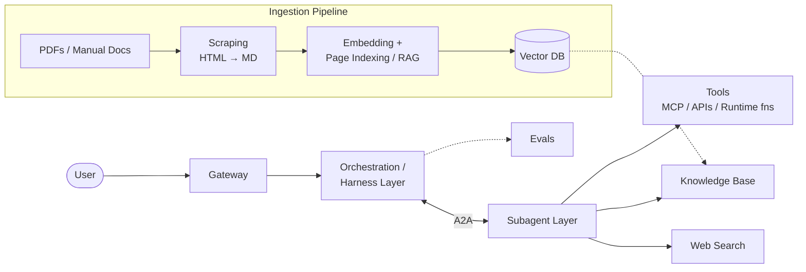

# Infogen

> **Information from information.**

Infogen is an agentic system that generates new information from existing sources - PDFs, manuals, docs, and the web - using orchestrated LLM subagents, RAG, and classical search-tree traversal (BFS / DFS / A*).

**Status:** 🚧 Design phase - the architecture below is **proposed**, not final.

---

## Proposed Architecture

## Components

| Component | Role |
|---|---|
| **Gateway** | Single entry point; routes user requests |
| **Orchestration / Harness** | Planning, task decomposition, subagent dispatch, aggregation |
| **Subagent Layer** | Specialized workers communicating via A2A |
| **Tools** | MCP servers, external APIs, runtime functions |
| **Knowledge Base + Vector DB** | RAG over ingested documentation |
| **Web Search** | Live retrieval beyond the local corpus |
| **Evals** | End-to-end quality measurement |

## Design Notes

- Knowledge is organized as a **tree** - O(log n) traversal instead of O(n) linear search
- Traversed with **BFS / DFS / A\*** depending on query shape
- **Hybrid retrieval** (keyword + vector) and **agent caching** planned